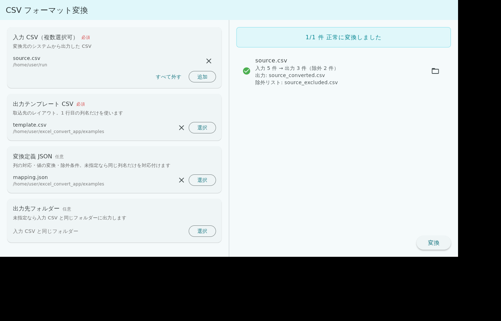

# CSV フォーマット変換（CSV Format Converter）

[](LICENSE)

システム間で受け渡す CSV のレイアウトを変換する Windows デスクトップアプリです。
「A システムから出力した CSV を、B システムの取込レイアウトに組み替える」作業を、**変換定義（JSON）** として保存し、何度でも同じ手順で再現できるようにします。

人事・給与・勤怠などの業務システムのデータ移行や、定期的な連携ファイルの作成を想定しています。



## 特長

- **テンプレートと変換ルールは利用時に読み込み** — アプリ自体に特定システムのレイアウトは含まれていません。出力テンプレート CSV（列名の行）と変換定義 JSON を用意すれば、任意のシステム間の変換に使えます
- **複数ファイルの一括変換** — 同じテンプレート・変換定義で、複数の入力 CSV をまとめて変換できます
- **日本の業務データ向けの機能**
  - Shift_JIS（Windows-31J）/ UTF-8（BOM 有無）の自動判定と出力。髙・﨑・① などの機種依存文字にも対応
  - 全角・半角の変換（半角カナの濁点を含む）、ひらがな→カタカナ
  - 日付の書式統一（`1985/4/1` → `19850401` など）、ゼロ埋め、値の置き換え表
  - 社員番号ごとの連番（扶養家族の通し番号など）
- **安全側に倒した動作**
  - 出力文字コードで表現できない文字（例: 𠮷）は、勝手に置き換えずエラーにして箇所を表示（設定で置き換えも可）
  - 除外条件に該当した行は、理由付きの「除外リスト CSV」に書き出し、黙って消さない
  - 変換定義が入力・出力の列と合っていない場合は、変換前にすべて列挙して中止
  - 既存のファイルは上書きせず、`(1)` などの連番を付けて出力
- **データを外部に送信しない** — ファイルはこの PC の中だけで処理されます

## 動作環境

| 項目 | 要件 |
|---|---|
| OS | Windows 10 / 11（64bit） |
| Node.js | 20 以上（[nodejs.org](https://nodejs.org/ja) から LTS 版をインストール） |

## 使い方

1. このリポジトリをダウンロード（`Code` → `Download ZIP`）し、PC の好きな場所に展開します
2. `csv_format_converter.exe` をダブルクリックして起動します
3. 次のファイルを選びます
   - **入力 CSV**（必須・複数可）… 変換元システムから出力した CSV
   - **出力テンプレート CSV**（必須）… 取込先のレイアウト。1 行目に列名だけが並んだ CSV
   - **変換定義 JSON**（任意）… 列の対応・値の変換・除外条件。省略すると同じ列名だけを対応付けます
   - **出力先フォルダー**（任意）… 省略すると入力 CSV と同じフォルダーに出力します
4. **「変換」** を押します

出力テンプレート・変換定義・出力先は次回起動時にも引き継がれます。

### 出力されるファイル

| ファイル | 内容 |
|---|---|
| `<入力ファイル名>_converted.csv` | 変換結果 |
| `<入力ファイル名>_excluded.csv` | 除外条件に該当した行（行番号・除外理由・元データ）。該当がある場合のみ |

### 試してみる

[examples/](examples/) に架空のデータで動かせる一式があります。

| ファイル | 選ぶ欄 |
|---|---|
| `examples/source.csv` | 入力 CSV |
| `examples/template.csv` | 出力テンプレート CSV |
| `examples/mapping.json` | 変換定義 JSON |

## 変換定義の例

```json
{
  "name": "人事システムA → 給与システムB（従業員マスタ）",
  "output": { "encoding": "shift_jis", "newline": "crlf" },
  "exclude": [
    { "column": "在籍区分", "op": "eq", "value": "退職", "reason": "退職者のため除外" }
  ],
  "columns": {
    "社員コード": { "from": "社員番号", "transform": [{ "zeroPad": 6 }] },
    "カナ氏名":   { "concat": ["姓カナ", "名カナ"], "separator": " ", "transform": ["fullwidth"] },
    "生年月日":   { "from": "生年月日", "transform": [{ "date": "YYYYMMDD" }] },
    "障害者区分": { "from": "障害者区分", "map": { "1": "1一般", "2": "2特別", "*": "0" } },
    "明細区分":   { "value": "51" }
  }
}
```

書き方の詳細は [docs/mapping-spec.md](docs/mapping-spec.md) を参照してください。

## コマンドラインから使う

変換エンジンは Node.js のスクリプトなので、アプリを使わずにコマンドラインやタスクスケジューラから実行することもできます。

```bash
node node/bin/csv-convert.js --input examples/source.csv --template examples/template.csv --mapping examples/mapping.json --output output.csv
```

オプションは `node node/bin/csv-convert.js --help` で確認できます。

## 構成

```text
csv_format_converter.exe   アプリ本体（Flutter）
*.dll, data/               アプリの実行に必要なファイル
node/
  bin/csv-convert.js       変換エンジンの入口（アプリから呼び出す。CLI としても使える）
  src/                     変換エンジン本体（CSV 解析・文字コード・値変換・検証）
docs/                      変換定義の仕様書
examples/                  架空データのサンプル
```

変換エンジンは Node.js の標準機能だけで実装しており、npm パッケージのインストールは不要です。

## データの取り扱い

- 本アプリはネットワーク通信を行いません
- 実データを誤ってコミットしないよう、`.gitignore` で `examples/` 以外の CSV・Excel を除外しています
- Issue・Pull Request に実データを貼り付けないでください。詳しくは [SECURITY.md](SECURITY.md) を参照してください

## ライセンス

[MIT License](LICENSE)

同梱の Flutter エンジン等のライセンスは `data/flutter_assets/NOTICES` に記載されています。

本ツールは特定のソフトウェア製品・サービスとは関係ありません。変換結果は取込先システムの仕様に沿っているか、必ず利用者自身で確認してください。
